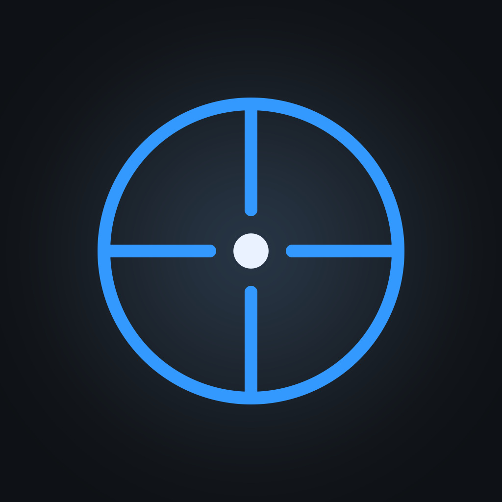

# Ballistic Calculator — Releases

Official release mirror for **Ballistic Calculator**, the offline long-range
ballistics calculator for Android.

  

## Download

The newest version is always the **top entry on the [Releases page](../../releases)** —
open that page on your Android phone and tap the `.apk` to install. Every version
keeps its own release notes there.

For a quick overview of the app — what it does, how to install it and the licence
terms — see the **[Ballistic Calculator site](https://ruddy19.github.io/Ballistic-Calculator-Releases/)**.

Install: download the APK on your Android device and open it. The first time,
Android asks you to allow installing apps from this source — tap **Settings** on
that prompt, switch on **Allow from this source**, then go back and tap **Install**.

> If Google Play Protect shows an "App scan recommended" step, let the scan finish
> before retrying — a timed-out scan can report "App not installed".

**Which file?** Each release carries two APKs:
`Ballistic-Calculator-<version>.apk` for 64-bit ARM phones — essentially every phone
sold since 2016 — and `Ballistic-Calculator-<version>-universal.apk`, which adds the
older 32-bit ARM build. Install the first one; if Android refuses it, the universal
APK is the one for that device.

## What it does

- **Trajectory table** from 50 m to 1000 m: drop, windage, MOA, kinetic energy,
  time of flight and scope clicks for your own click value.
- **Wind matrix** — drift and holds across 2–20 m/s crosswinds (5–45 mph), in
  cm/inches, MOA or clicks.
- **G1 and G7 point-mass solver** — the BC's own drag function is used, so a
  G7-quoted match bullet is applied and solved as G7.
- **Shot angle correction** — enter the incline to the target and the drops
  read the holds for uphill and downhill shots.
- **Metric or imperial** — every screen reads in yards, fps, inches, mph, inHg
  and °F, or metric; the display toggle never changes the saved setup.
- **Ammunition lookup** over a bundled library of published factory loads, component
  bullets and reference starting loads, searchable by cartridge.
- **Caliber catalogue** of 150+ rifle cartridges, plus any custom caliber you add.
- **Current weather** from MET Norway — temperature, station pressure and wind filled
  straight into the environment inputs.
- **Offline everywhere else.** Setups, custom calibers and preferences are saved on
  the device; only the weather tab needs a connection.

## Earlier versions

Every build is listed on the [Releases page](../../releases) with its own APK and
notes. The five most recent:

| Version | Released | 64-bit APK | Universal APK | What changed |
| --- | --- | --- | --- | --- |
| [1.2.2](../../releases/tag/v1.2.2) | 18 Nov 2026 | 30.5 MB | 87.6 MB | Fixes the Inputs tab crashing on open and its broken layout — installs over any previous version |
| [1.2.1](../../releases/tag/v1.2.1) | 18 Nov 2026 | 30.5 MB | 87.6 MB | Install hardening: trial clock survives clock changes, signing-key rotation support |
| [1.2.0](../../releases/tag/v1.2.0) | 18 Nov 2026 | 30.5 MB | 87.6 MB | G7 drag model, imperial units, shot-angle (cosine) correction |
| [1.1.0](../../releases/tag/v1.1.0) | 15 Nov 2026 | 30.4 MB | 87.6 MB | Licence keys, a 14-day trial, a licence screen and a first-launch EULA |
| [1.0.0](../../releases/tag/v1.0.0) | 15 Nov 2026 | 30.4 MB | 87.5 MB | First release |

## Updates

Each release installs over the top and keeps your saved setups, custom calibers and
preferences. There is no separate updater to install.

## Licensing

Ballistic Calculator is **commercial software, licensed and not sold**. The
end user licence terms are in [EULA.md](EULA.md) and are also shown in the app on
first launch.

The app runs a **14-day trial** with every feature unlocked. After that a licence
key is required: it is checked on the device, so no connection is needed to keep
using the app. Keys are issued to an email address, and revoked keys are listed in
[revoked.json](revoked.json), which the app reads when it can reach it.

Bundled open-source packages remain under their own licences; the app lists every
one of them, with its verbatim licence text, under **Privacy → Third-party licences**.

## Privacy

See [PRIVACY.md](PRIVACY.md). In short: no account, no analytics, no advertising.
Inputs and custom calibers stay on the device. The only network request is the
weather tab asking MET Norway for conditions at your approximate location, and only
when you open that tab.

## Source

The application source is maintained in a **private** repository. This mirror is the
public distribution channel and holds release artifacts only.
